# Station Production Overview

Adds a **Production Overview** tab to the info panel tab strip in the map menu (alongside Object Info, Crew, etc.) for player-owned stations. Shows per-ware production and consumption rates, groups wares into Products, Intermediates, and Resources, and previews the impact of planned (not yet built) modules.

## Features

- **Production Overview Tab**: Dedicated tab in the station info panel showing per-ware produced, consumed, and net total rates per hour.
- **Sector Production Overview**: Same tab in the sector info panel, listing all player-owned production stations in the sector.
- **Ware grouping**: Wares split into **Products**, **Intermediates**, and **Resources**; workforce-only consumer goods placed in Resources unless also produced on-site.
- **Live vs Estimated mode**: Dropdown switches between actual running rates (with `active/total` module count) and the output with all modules running at the current workforce.
- **Production issue indicators**: Wares with destroyed, damaged, hacked, paused, resource-starved or storage-blocked modules are highlighted, with the count per state as a sub-row or a tooltip.
- **Planned module preview**: A delta row per ware shows the production impact of unbuilt modules in the construction plan.
- **Empire balance**: Optional *All stations:* sub-row (toggle via **Show empire balance** checkbox, single-station view only) shows empire-wide production, consumption, and coloured surplus/deficit for each Product, Intermediate and Resource that stations can produce (mined and salvaged wares are left out).
- **Storage view**: Optional *Stock:* sub-row per ware (amount / allocated storage, time until empty or full) and a **Storage** group with the fill level, hourly volume flow and capacity of each storage type (toggle via **Show storage** checkbox).
- **Sector total**: The sector view starts with the per-ware sum of all its player stations.
- **Sorting**: Wares sorted by name or by balance, deficits first.
- **Quick-navigation buttons**: *Configure Station* and *Station Overview* at the bottom of the tab.
- **Configurable data refresh**: Slider in options sets the cache duration in UI ticks (1-10, default 3).
- **Error handling options**: Options to show production issues as sub-rows instead of tooltips, and to ignore specific module states when identifying issues.
- **Interoperability option**: Option to synchronize data refresh interval and error handling settings with the `Production Stations Tab` mod (if installed).
- **Supports 8.00 and 9.00**: Compatible with both 8.00 and 9.00 versions of the game.

## Requirements

- **X4: Foundations**: Version **8.00HF4** or higher and **UI Extensions and HUD**: Version **v8.0.4.3** or higher by [kuertee](https://next.nexusmods.com/profile/kuertee?gameId=2659).
  - Available on Nexus Mods: [UI Extensions and HUD](https://www.nexusmods.com/x4foundations/mods/552)
- **X4: Foundations**: Version **9.00** or higher and **UI Extensions and HUD**: Version **v9.0.0.0.3** or higher by [kuertee](https://next.nexusmods.com/profile/kuertee?gameId=2659).
  - Available on Nexus Mods: [UI Extensions and HUD](https://www.nexusmods.com/x4foundations/mods/552)
- **Mod Support APIs**: Version 1.95 or higher by [SirNukes](https://next.nexusmods.com/profile/sirnukes?gameId=2659).
  - Available on Steam: [SirNukes Mod Support APIs](https://steamcommunity.com/sharedfiles/filedetails/?id=2042901274)
  - Available on Nexus Mods: [Mod Support APIs](https://www.nexusmods.com/x4foundations/mods/503)
- **Options Helper**: Version 1.10 or higher.
  - Available on Steam: [Options Helper](https://steamcommunity.com/sharedfiles/filedetails/?id=3715253556)
  - Available on Nexus Mods: [Options Helper](https://www.nexusmods.com/x4foundations/mods/2089)
- **Print Extension List**: Version 1.00 or higher.
  - Available on Steam: [Print Extension List](https://steamcommunity.com/sharedfiles/filedetails/?id=3770927339)
  - Available on Nexus Mods: [Print Extension List](https://www.nexusmods.com/x4foundations/mods/2191)

## Installation

- **Steam Workshop**: [Station Production Overview](https://steamcommunity.com/sharedfiles/filedetails/?id=3695609478) - for **Game version 9.00** or higher.
- **Nexus Mods**: [Station Production Overview](https://www.nexusmods.com/x4foundations/mods/2049)

## Save state

**No** (removing the extension does not break saves).

## Usage

Open the map, select a player-owned station, and click the **Production Overview** tab in the info panel (left or right side).

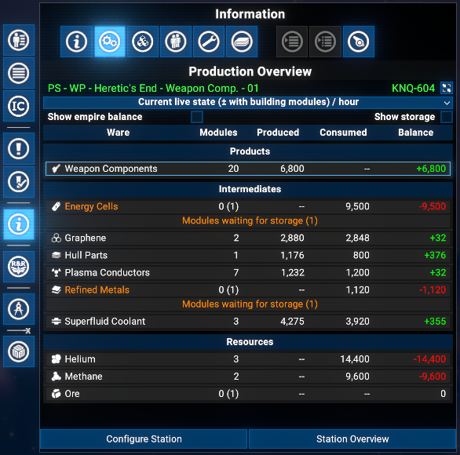

### Live vs Estimated mode

The dropdown switches between **Current (live state)** (actual running rates; Modules column shows `active/total`) and **Estimated (all modules active)** (every module running, with the workforce bonus of the workers present now).

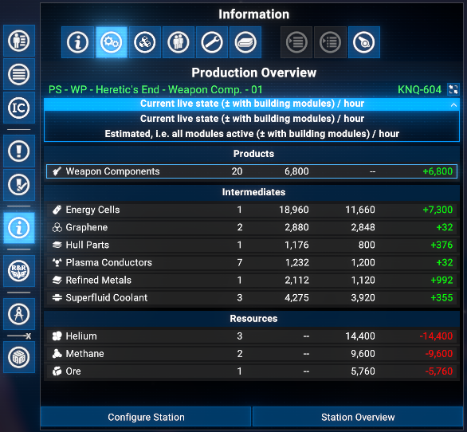
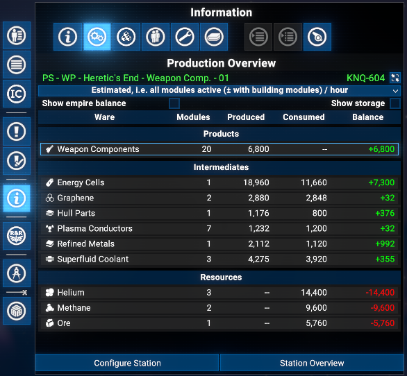

### Ware groups

- **Products**: produced here, not consumed on-site.
- **Intermediates**: produced and consumed internally.
- **Resources**: consumed as inputs, not produced on-site.

Workforce-only consumer goods (food, medicine, etc.) also appear here unless produced on-site (from version 9.00.08).

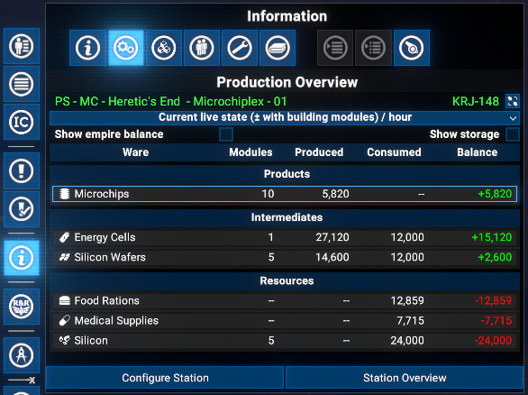
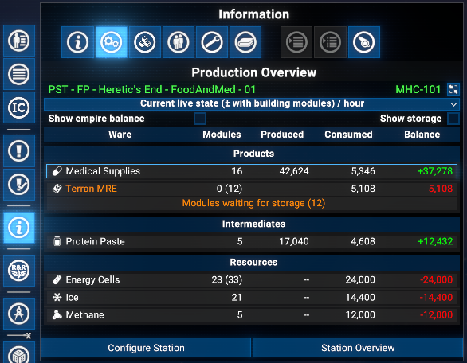

### Planned module preview

If the construction plan has unbuilt modules, a delta row per ware shows `(+N)` planned modules and their additional production/consumption.

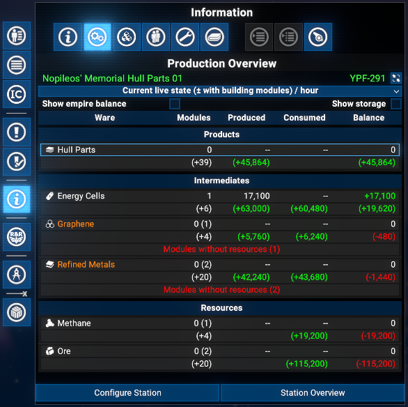

### Empire balance

Enable the **Show empire balance** checkbox (single-station view only) to show an *All stations:* sub-row per Product, Intermediate and Resource with empire-wide production, consumption, and a coloured balance (green = surplus, red = deficit). Resources without any production method (mined ores and gases, raw scrap) get no such row, since no station can produce them. Respects Live / Estimated mode.

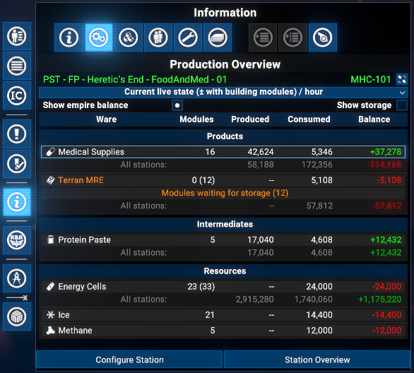

### Storage

Enable the **Show storage** checkbox to add a *Stock:* sub-row under each ware: the amount on the station, the storage allocated to it, and when it runs empty or full at the current balance, coloured red, yellow or green by the time left (limits set in the options). A **Storage** group at the end lists each storage type with its fill level, the hourly volume produced and consumed, and its capacity. A storage type the station needs but does not have is shown in red, in the Storage group and under each ware that needs it.

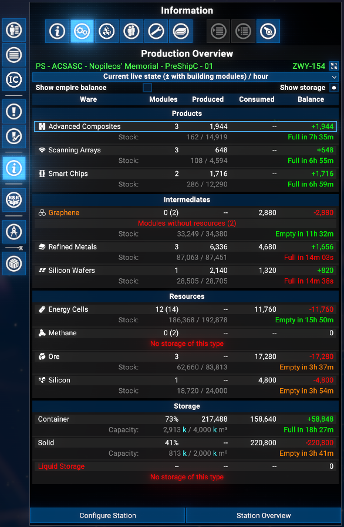

### Module states

In Live mode a ware is highlighted when any of its modules is destroyed, damaged, hacked, paused, waiting for resources or waiting for storage; the counts per state appear as a sub-row or a tooltip.

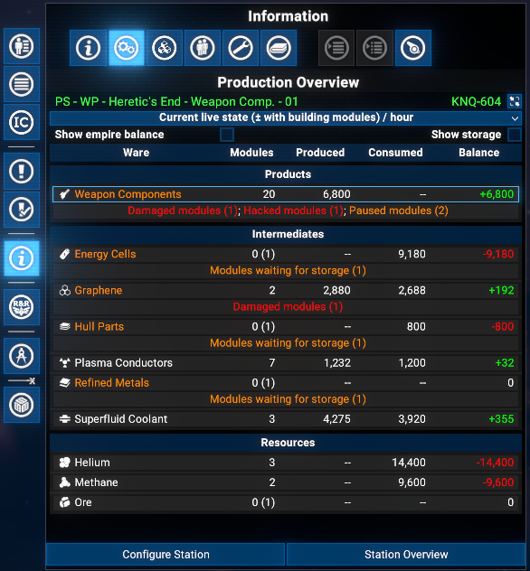

### Extensions options

**Options Menu > Extension options > Station Production Overview**:

- **Data Refresh Interval** (1-10, default 3): UI ticks to reuse cached data before recomputing. Lower = more responsive, higher = less CPU.
- **Sort by**: wares by **Name** or by **Balance (deficit first)**.
- **Red: empty or full within** (1-24 hours, default 2) and **Yellow: empty or full within** (default 6): a stock forecast below the red limit is shown in red, below the yellow limit in yellow, otherwise in green. The red limit cannot exceed the yellow one.
- **Show errors as sub-rows**: if checked, the error states of modules are shown as sub-rows under each ware instead of tooltips on the ware name.
- **Ignore errors**:
  - **Modules without resources**: if checked, this module state is ignored when identifying production issues,
  - **Modules waiting for storage**: if checked, this module state is ignored when identifying production issues,
  - **Paused modules**: if checked, modules you paused yourself are not shown as an issue.
- **Synchronize with Production Stations Tab**: if enabled, the data refresh interval and error handling settings are kept in sync between this mod and the `Production Stations Tab` mod (if installed).
- **Debug Level**: None, Debug or Trace; writes the mod's diagnostics to the game log.

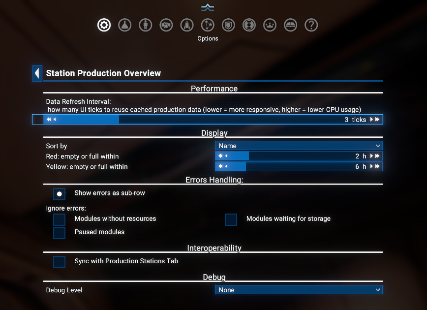

### Sector Production Overview

Select a sector in the map to get the same **Production Overview** tab listing all player-owned production stations in that sector. With more than one station, a **Sector total** block first sums every ware over all of them.

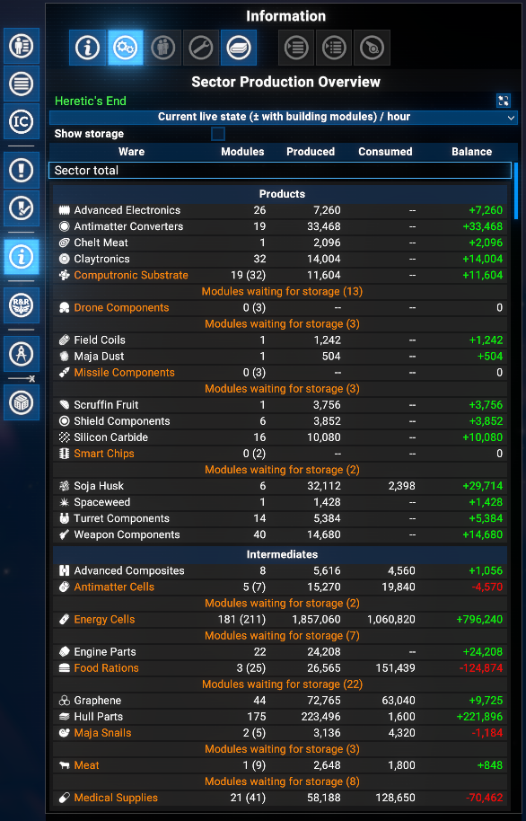

## Video

- [Station Production Overview and Production Stations Tab interoperability setting and usage](https://www.youtube.com/watch?v=f0apJSuumY0)

## Credits

- **Author**: Chem O`Dun, on [Nexus Mods](https://next.nexusmods.com/profile/ChemODun/mods?gameId=2659) and [Steam Workshop](https://steamcommunity.com/id/chemodun/myworkshopfiles/?appid=392160)
- *"X4: Foundations"* is a trademark of [Egosoft](https://www.egosoft.com).

## Acknowledgements

- [EGOSOFT](https://www.egosoft.com) - for the X series.
- [kuertee](https://next.nexusmods.com/profile/kuertee?gameId=2659) - for the `UI Extensions and HUD` that makes this extension possible.
- [SirNukes](https://next.nexusmods.com/profile/sirnukes?gameId=2659) - for the `Mod Support APIs` that power the UI hooks.

## Changelog

### [9.00.11] - 2026-10-16

- **Added**
  - *Show storage* checkbox: stock per ware with the time until empty or full, and a Storage group per storage type.
  - Options for the hours under which the empty or full forecast turns red or yellow.
  - Sector total block at the top of the sector view.
  - Destroyed, damaged, hacked and paused modules are detected, as in the vanilla Station Overview.
  - Option to ignore paused modules.
  - Option to sort wares by balance, deficits first.
  - Debug level option in the Extension options.
  - Empire balance for Resources too, except mined and salvaged wares.
- **Changed**
  - The options page uses `Options Helper`; `Options Helper` and `Print Extension List` are now required.
  - Empire balance counts the current workforce in both modes, like the station rows.
- **Improved**
  - Faster refresh: each station is scanned once per refresh.

### [9.00.10] - 2026-06-18

- **Changed**
  - On Steam: restricted to game version 9.0 or higher.

### [9.00.09] - 2026-04-26

- **Added**
  - New option to display production issues as sub-rows under each ware instead of tooltips on the ware name.
  - New option to ignore modules without resources and/or modules waiting for storage when identifying production issues.
  - New option to synchronize data refresh interval and error handling settings with the `Production Stations Tab` mod (if installed).

### [9.00.08] - 2026-04-19

- **Added**
  - Workforce resource consumption: food, medicine, and other wares consumed only by workforce now appear in the Resources group.
  - Empire balance: an optional *All stations:* sub-row shows empire-wide production and consumption for each Product and Intermediate ware with a coloured surplus/deficit balance. Available in single-station view only.
- **Improved**
  - Data cache throttle: expensive C API calls are reused for `dataRefreshInterval` UI ticks before recomputing. Configurable in the Extensions options menu (default 3, range 1-10).

### [9.00.07] - 2026-04-10

- **Improved**
  - Added possibility to be distributed via Steam after upgrade Steam version the `UI Extensions and HUD` mod.

### [9.00.06] - 2026-04-06

- **Improved**
  - Added possibility to work under the v.8.00 of the game in case of usage the 8.0.4.3 version of the `UI Extensions and HUD` mod.

### [9.00.05] - 2026-04-02

- **Fixed**
  - Production overview table used too-small font for ware names and module counts on higher screen resolutions. Introduced in v9.00.04.

### [9.00.04] - 2026-04-01

- **Improved**
  - Ware icon is now displayed next to the ware name in each row.
  - Production issue highlighting: if any modules for a ware are waiting for resources or waiting for storage the ware name changes to warning colour and a mouseover tooltip shows the counts per issue state.

### [9.00.03] - 2026-03-31

- **Added**
  - **Sector Production Overview**: A new tab in the sector info panel that lists all player-owned production stations in the sector with their production data, equal to the single station production overview.

### [9.00.02] - 2026-03-31

- **Fixed**
  - Disappearing the info menu on a right panel when this mod enabled tab is selected

### [9.00.01] - 2026-03-30

- **Added**
  - Initial public version
